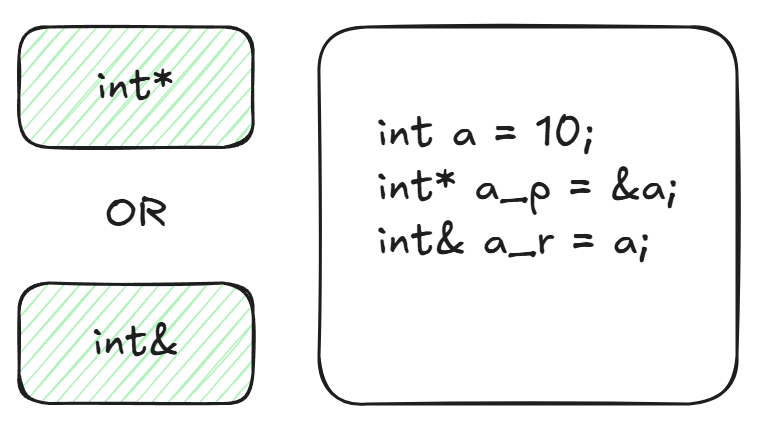

+++
date = '2026-10-12T10:30:48+08:00'
draft = true
title = 'Understanding the Essence 1 - C++ References'
+++

## Introduction

In traditional C language, we often use pointers as function parameters to avoid copying or manipulating variables themselves instead of copies. But as long as pointers are used, there will always be some classic development issues, such as resource request and release issues, null pointer access issues, and the need to use -> access when using pointers to access structures

C++ introduced the concept of referencing, and I have read many online tutorials that explain it in layman's terms as giving a variable an alias. This approach may lead many beginners to understand referencing as an alternative renaming feature?



In my opinion, C++ references are essentially a syntactic sugar of pointers. References and pointers are considered exactly the same thing by the underlying compiler, just to facilitate programmers to write safer and more readable code

C++ references force programmers to bind to an existing object, and null references are not allowed in the code. Additionally, they are used in much the same way as regular variables, serving as a restricted and safer pointer

## Underlying

```cpp
void test01() {
    int a = 10;
    int* a_p = &a;
}

void test02() {
    int a = 10;
    int& a_r = a;
}
```

```assembly
# x86-64 GCC

"test01()":
        push    rbp
        mov     rbp, rsp
        mov     DWORD PTR [rbp-12], 10
        lea     rax, [rbp-12]
        mov     QWORD PTR [rbp-8], rax
        nop
        pop     rbp
        ret
"test02()":
        push    rbp
        mov     rbp, rsp
        mov     DWORD PTR [rbp-12], 10
        lea     rax, [rbp-12]
        mov     QWORD PTR [rbp-8], rax
        nop
        pop     rbp
        ret
```

You can see that the assembly implementation corresponding to references and pointers is actually the same